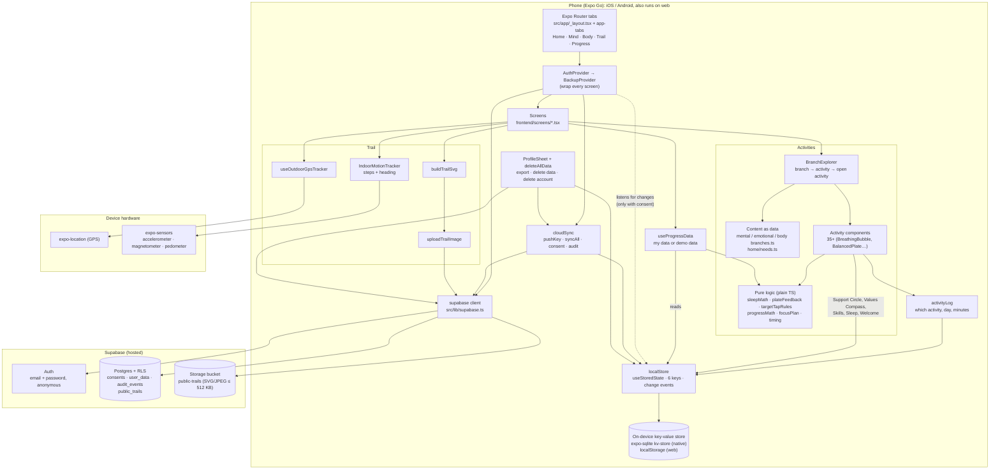

# Build - Architecture

How the parts of MyGrowth connect in the code as built (commit `e1a35f4`). The
earlier plan in [design/diagrams/03-architecture.md](../design/diagrams/03-architecture.md)
had a custom API server, scoring service, and moderation workflow. None of those
were built. The app talks straight to Supabase, and Postgres row-level security
(RLS) does the job the planned API would have done.

## What each part does

| Part | Where | What it does |
| --- | --- | --- |
| Routing | `src/app/` | One thin file per tab that renders the matching screen. `_layout.tsx` wraps everything in `AuthProvider` and `BackupProvider`. |
| Screens | `frontend/screens/` | Home (tap figure, need finder, welcome), Mind, Body, Trail, Public Trails, Progress. |
| BranchExplorer | `frontend/components/common/BranchExplorer.tsx` | One navigator for Mind and Body: branch list → activity list → activity. Handles Android back. |
| Content | `*/branches.ts`, `home/needs.ts` | Branches and activities are data, so most new activities need no new screen code. |
| Pure logic | `sleepMath.ts`, `plateFeedback.ts`, `progressMath.ts`, … | Calculations with no React or storage, so they can be tested on their own. |
| localStore | `common/localStore.ts` | The only way activities save data. Six keys under the `mygrowth:` prefix, with a timestamp per key and change events. |
| Storage adapter | `storage.native.ts` / `storage.ts` | expo-sqlite key-value store on phones, `localStorage` on web. The platform picks the file. |
| Activity log | `common/activityLog.tsx` | Records that an activity was finished: id, day, minutes (plus drink count and food groups). Never what the user typed. Kept 365 days, max 500 entries. |
| Progress | `progress/useProgressData.ts` | The single data seam for the Progress page. Builds charts from the activity log and sleep logs, or shows labelled demo data. |
| Trail | `components/trail/` | Outdoor: GPS fixes worse than 25 m accuracy are dropped. Indoor: steps from the accelerometer, direction from the magnetometer. Draws an SVG and can upload it to the public gallery. |
| Auth | `auth/AuthProvider.tsx` | Optional email + password account. The app works without one. Anonymous sessions (used for trail sharing) don't count as signed in. |
| Backup | `sync/BackupProvider.tsx`, `sync/cloudSync.ts` | Off by default. With consent, uploads each changed key 2 s after the change. On sign-in and on return to the app (at most every 5 min) a two-way sync runs where the newer copy of each key wins. |
| Data rights | `profile/deleteAllData.ts` | Export (JSON via the share sheet), delete all data (phone + backup + shared trails), delete account (`delete_my_account()` RPC). |
| Supabase | `backend/supabase/*.sql` | Tables, RLS policies, consent trigger, audit log, account-deletion function, upload limits. |

## Key design decisions

1. **No custom API server.** The app calls Supabase directly, and RLS policies
   make sure each user can only read or change their own rows (LR4). This kept
   the prototype small. The cost is that business rules live in SQL policies
   and triggers, not in one API layer.
2. **On-device first.** All activity data is saved on the phone. Nothing is
   sent anywhere unless the user signs in *and* turns on backup (LR1, LR2).
3. **The database enforces consent, not just the app.** `user_data` only
   accepts writes from a real (non-anonymous) user with an active backup
   consent. Withdrawing consent fires a trigger that deletes the backup copy
   and writes an audit row (LR1, LR3, LR6).
4. **Newest copy wins, per key.** Each key carries its last-changed time, so
   sync is simple and works offline. Deleting data records a deletion time, so
   an old backup can't bring deleted data back.
5. **One adapter boundary per platform concern.** Storage (`storage.native.ts`
   / `storage.ts`), maps (`TrailMap.native.tsx` / `.web.tsx`), and tabs
   (`app-tabs.tsx` / `.web.tsx`) swap by file extension, so screens don't
   branch on platform.

## Legal requirements as built

| Rule | How the build meets it | Gap |
| --- | --- | --- |
| LR1 Privacy and consent | Welcome notice with version; backup consent row stores version, `accepted_at`, `withdrawn_at`. | Welcome-notice acceptance is stored only on the device. |
| LR2 Data minimization | Activity log keeps no typed text; most activities keep nothing after closing. | - |
| LR3 User rights | Export, delete all data, delete account, per-activity delete. | No in-app correction beyond editing saved items. |
| LR4 Access control | RLS on every table and on storage paths (`<user id>/…`). | Gallery images are public by design. |
| LR5 Safety | Need finder shows a line pointing to someone trusted or a local support line. | No dedicated safety-support screen with real resources yet. |
| LR6 Audit records | `audit_events` (insert-only, unreadable through the API): backup on/off, export, data deleted, account deleted. Purged after 180 days. | Sign-in events rely on Supabase Auth's own logs. |
| LR7 Electronic records | Consent and deletion events kept in the database. | Terms and disclaimer versions are not stored server-side. |
| LR8 Claims | Privacy text says it is not therapy or diagnosis and makes no approval claims. | - |

**Also not built:** moderation, reporting, or removal of public trail images by
anyone other than the uploader. CLAUDE.md requires these for any community
content, so the public gallery needs them before real users can share to it.
