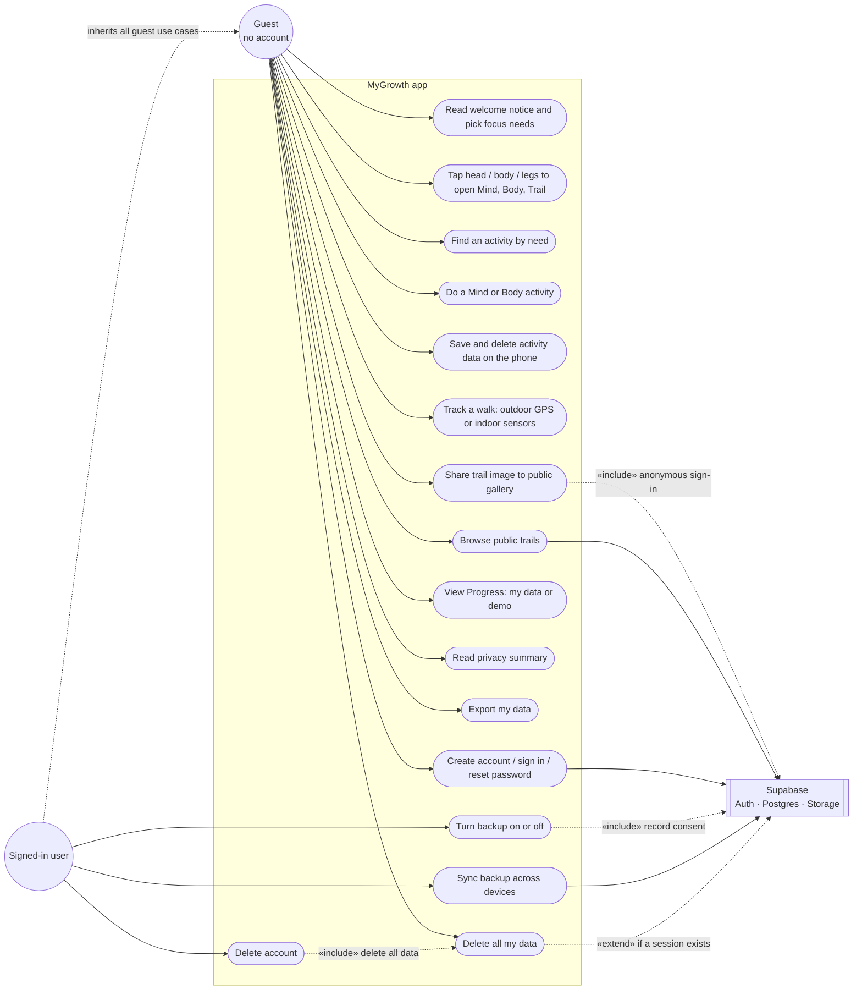
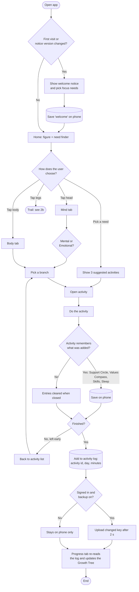
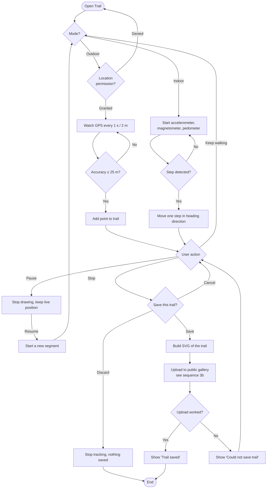
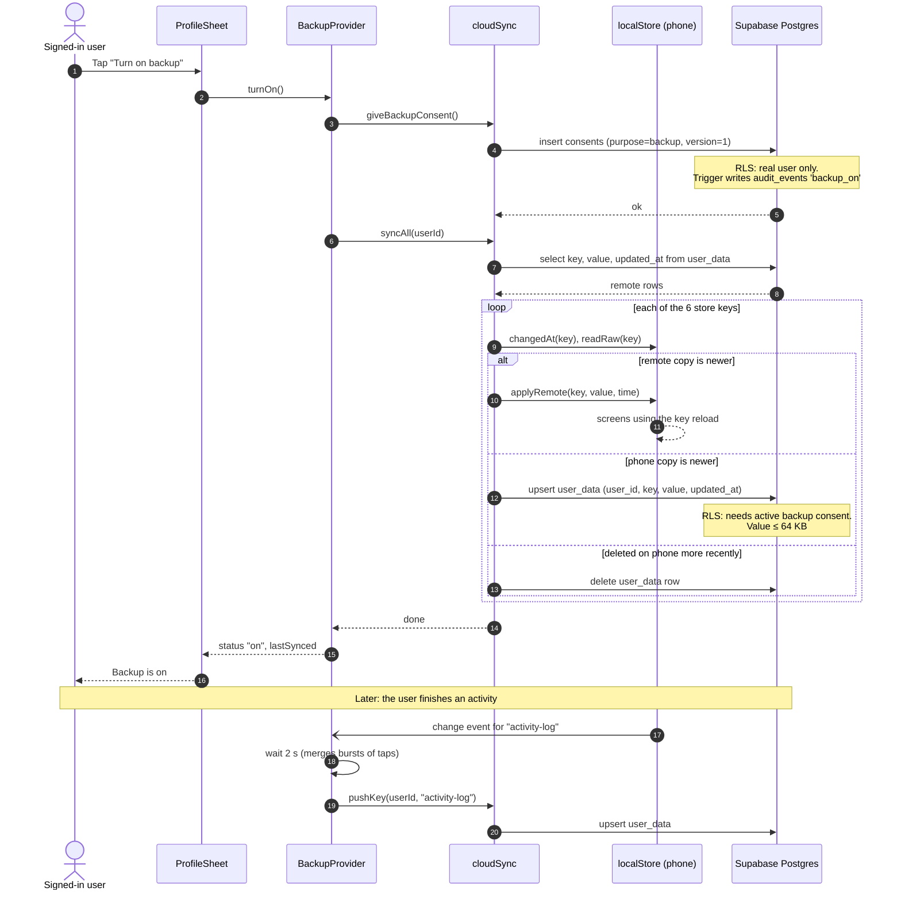
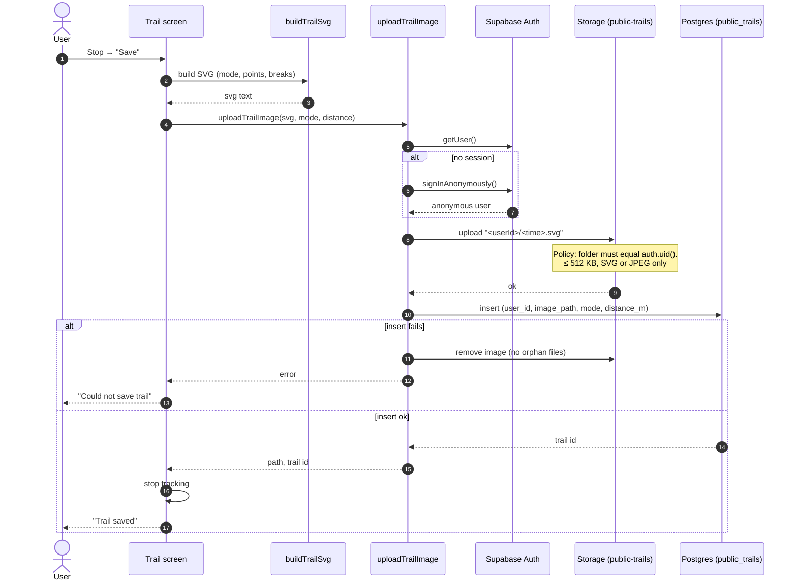
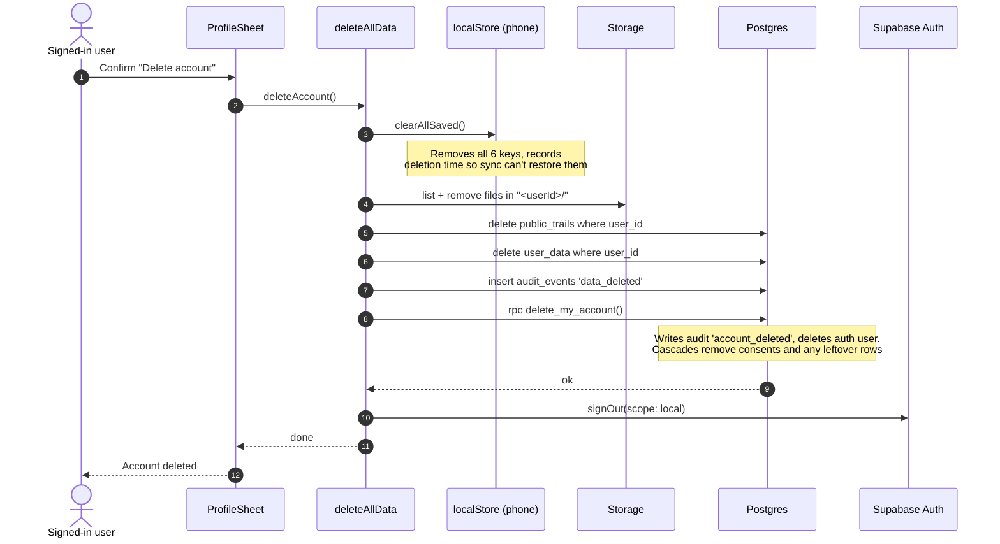
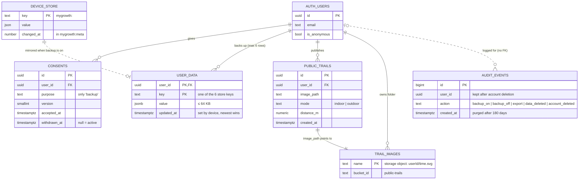

# Build - Diagrams

UML views of MyGrowth as built (commit `e1a35f4`). For how the parts connect,
see [architecture.md](architecture.md). The planned versions from the design
phase are in [design/diagrams/](../design/diagrams/).

1. [Use case](#1-use-case)
2. [Activity](#2-activity)
3. [Sequence](#3-sequence)
4. [Entity-relationship](#4-entity-relationship)

---

## 1. Use case

Three kinds of user. A **guest** has no account. A **signed-in user** has an
email + password account and can do everything a guest can, plus backup and
account actions. Anyone can browse public trails.

| Use case | Code entry point | Rule |
| --- | --- | --- |
| UC1 | `home/Welcome.tsx` | LR1, LR8 |
| UC2, UC3 | `screens/home.tsx`, `home/NeedFinder.tsx` | LR5 (support line text) |
| UC4, UC5 | `common/BranchExplorer.tsx`, `common/localStore.ts` | LR2, LR3 |
| UC6, UC7 | `screens/trail.tsx`, `trail/saveTrailImage.ts` | LR4 |
| UC8 | `screens/public-trails.tsx` | - |
| UC9 | `screens/progress.tsx`, `progress/useProgressData.ts` | LR8 (demo label) |
| UC10-UC12, UC16 | `profile/ProfileSheet.tsx`, `profile/deleteAllData.ts` | LR3, LR6 |
| UC13 | `auth/AuthProvider.tsx`, `auth/AuthSheet.tsx` | LR4 |
| UC14, UC15 | `sync/BackupProvider.tsx`, `sync/cloudSync.ts` | LR1, LR6, LR7 |

---

## 2. Activity

### 2a. Doing an activity

From opening the app to the activity showing up on Progress.

### 2b. Trail session

---

## 3. Sequence

### 3a. Turn on backup, then sync

### 3b. Share a trail to the public gallery

### 3c. Delete account

---

## 4. Entity-relationship

Server tables come from `backend/supabase/schema.sql` and `backup.sql`. The
on-device store is shown too, because most data lives there and `user_data` is
a copy of it.

**Device store keys:** `support-circle`, `values-compass`, `skills`, `sleep`,
`welcome`, `activity-log`. The same list is enforced by a check constraint on
`user_data.key`.

**Access rules (RLS):** users read and change only their own `consents`,
`user_data`, and trail rows. Writes to `user_data` also need an active backup
consent and a non-anonymous user. `audit_events` is insert-only, with no reads
through the API. Anyone can read `public_trails` and the trail images.

**Not shown:** `grounding_sessions` and `grounding_answers` are still in
`schema.sql` but the app no longer writes to them.
